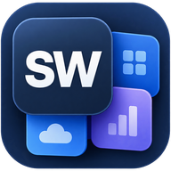
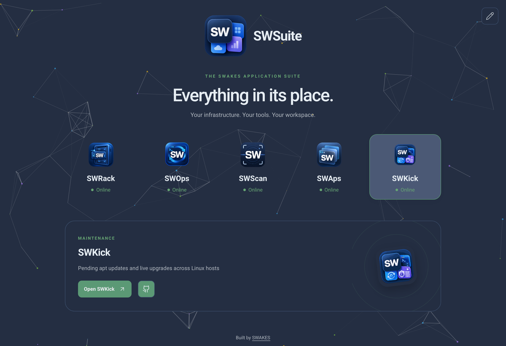

<p align="center">
  
</p>

<h1 align="center">SWSuite</h1>

<p align="center">
  Five self-hosted homelab apps behind one portal and one <code>docker compose up</code>.
</p>

<p align="center">
  <a href="LICENSE"></a>
  
  
</p>

<p align="center">
  
</p>

| App | What it does | Path | Direct port |
|---|---|---|---|
| **Portal** | The launcher, with a live status light per app | `/` | `80` |
| **SWRack** | Visual rack and data-cabinet documentation | `/rack` | `8088` |
| **SWOps** | Asset inventory, connection trails and QR labels | `/ops` | `8085` |
| **SWScan** | Walk a room on video, get an AI-built item catalogue | `/scan` | `7734` |
| **SWAps** | Generate and deploy Linux provisioning over SSH | `/swaps` | `8080` |
| **SWKick** | Pending apt updates and live upgrades across Linux hosts | `/kick` | `8000` |

Everything is served from one hostname, so a reverse proxy in front of it
needs a single entry.

## Requirements

- A Linux host with Docker Engine and the Compose v2 plugin
- About 4 GB of RAM and a few GB of disk for images
- Optional: an Anthropic, OpenAI or Google API key for SWScan's vision features

## Install

```bash
git clone https://github.com/pqpxo/swsuite_public.git swsuite
cd swsuite
./scripts/bootstrap.sh
```

`bootstrap.sh` creates `.env` from `.env.example`, makes the data folders,
and runs `scripts/init-swkick.sh`, which generates SWKick's vault key and
secrets and prints its first `admin` password.

Then edit `.env`:

- `POSTGRES_PASSWORD` and `INVENTORY_SECRET_KEY`: set both to long random values.
- `INVENTORY_BASE_URL`: this host's address as other devices reach it, for
  example `http://192.168.1.50`, so printed QR labels open from a phone.
- AI provider keys, if you want SWScan's vision features.

Start it:

```bash
docker compose up -d --build
```

The portal is then at `http://<this-host>`. The first build takes a few
minutes.

## How it works

Caddy serves the portal at `/` and routes each path to its app's container.
It strips the prefix before forwarding and sends `X-Forwarded-Prefix`, so
every app still sees itself at its own root and puts the prefix back into the
links it emits.

```
  browser  →  <host>:80  →  Caddy
                             ├── /        portal
                             ├── /rack    SWRack
                             ├── /ops     SWOps
                             ├── /scan    SWScan
                             ├── /swaps   SWAps
                             └── /kick    SWKick
```

Each app also publishes its own port for direct access. SWRack and SWOps have
their mount path built in, so use them through the portal.

The portal's tiles can be reordered: press the pencil button at the top right,
then drag. The order is saved per browser.

## Adding a domain and HTTPS

Put any reverse proxy in front (NGINX Proxy Manager, Traefik, another Caddy)
and point one hostname at `<this-host>:80`. Turn on WebSocket support (SWAps'
deploy console), turn off response buffering (SWKick's live upgrade output),
and allow large uploads (SWScan accepts video up to 2 GB). Then set
`INVENTORY_BASE_URL` to the new `https://` address and run
`docker compose up -d homelab-inventory`.

## Data and backups

- `./data` (or `SUITE_DATA` in `.env`): SWOps, SWScan and SWKick data.
- `./secrets/swkick-master.key`: decrypts the SSH credentials SWKick stores.
  Back it up, but not alongside `./data`.
- Docker volumes `swsuite_rack_postgres_data` and `swsuite_rack_asset_data`:
  SWRack's database and uploads.

## Updating

```bash
git pull --ff-only
docker compose up -d --build
docker compose restart proxy     # only needed when caddy/Caddyfile changed
```

## Security

This is built for a trusted LAN. Only SWKick has a login of its own; the
portal and the other apps have none. SWAps and SWKick hold SSH access to your
hosts. Do not expose the suite to the internet without adding authentication
at your reverse proxy first.

## Adding your own app

Put it in `apps/<name>`, add a service to `docker-compose.yml`, add a
`handle_path` route and a `/healthz/<id>` probe to `caddy/Caddyfile`, and add
an entry and a 256×256 logo to `portal/config.js` and `portal/assets/apps/`.
SWKick is the most recent example to copy.

## Licence

MIT. See [LICENSE](LICENSE).
